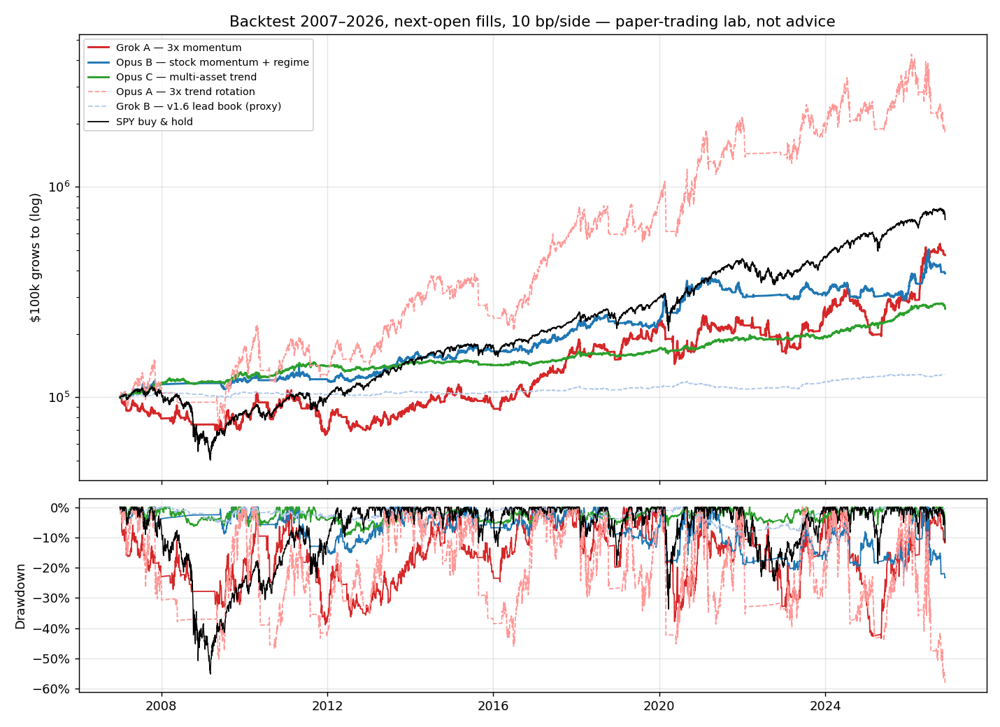

## Vibe Coding an Algo-Trading Bot

This project is an ongoing experiment at the intersection of two things I want to get
sharper at: **AI-assisted software development** and **quantitative trading**.

The premise is simple — rather than hand-writing every line, I build and iterate on the
bot by *directing an AI coding assistant* in plain language: describing the behavior I
want, reviewing the code it produces, correcting course, and learning the underlying
concepts as I go. "Vibe coding," but with guardrails: I read every diff, keep secrets out
of the repo, and validate against a sandbox before anything touches real markets.

### Why paper trading first

The bot runs against [Alpaca](https://alpaca.markets)'s **paper-trading** API — a full
simulated brokerage with a fake balance and live market data, but zero real money at
risk. It's the right way to learn: I can let strategies run, break things, and measure
results without a dollar on the line. API keys authenticate the bot instead of a
password, and credentials live in a git-ignored `.env` file — never in the repository.

### The stack

- **Python** with the official `alpaca-py` SDK
- **Alpaca paper-trading API** for market data, account state, and order execution
- **A secure local setup** — virtual environment, git-ignored secrets, read-only
  connection checks before any order logic
- **An AI coding assistant** as the pair-programmer driving implementation

### A first milestone — connecting to the account

The first checkpoint was a read-only connection: authenticate, pull the (simulated)
account, and confirm buying power before writing a single line of order logic.

```python
from alpaca.trading.client import TradingClient

# Paper-trading account — no real funds at risk
client = TradingClient(API_KEY, SECRET_KEY, paper=True)

account = client.get_account()
print(f"Status:        {account.status}")
print(f"Buying power:  ${account.buying_power}")
```

### What I'm learning

- How far AI-directed development can go on a real, non-trivial project — and where a
  human still has to own the judgment calls
- The mechanics of a modern brokerage API: order types, positions, market data
- Building the safety habits that matter *before* automating anything financial:
  sandboxing, secret management, and reviewing every change

This page grows as the experiment does. The newest chapter is below.

---

## Season 1: Grok vs. Opus, three autonomous paper portfolios (Nov 2026 →)

On **2026-11-23** I gave two frontier models the same prompt: xAI's **Grok 4.6** and
Anthropic's **Claude Opus 5.5**. Each designed three automated strategies for a
$100k Alpaca paper account at three risk levels, in an isolated session with no
tools, so neither saw the other's answer. I backtested five of the designs, picked
one per risk tier, and gave each one **its own paper account**. Since the
**2026-11-24** open they have run with **no human approval on any order**.

### Why compare models at all?

Public LLM trading contests exist, but they don't settle much:

- **Alpha Arena Season 1** (Oct–Nov 2025, real money, crypto): Claude Sonnet 4.5 finished
  about **−31%**, Grok 4 about **−45%**. Only two models made money.
- **Alpha Arena Season 1.5** (US stocks): **Grok 4.20 won** with about **+12%** over two weeks.
  Claude Sonnet lost again.
- **Late-2026 paper leaderboards** are split. Opus leads some, Grok leads others. Grok
  tends to make bigger, concentrated bets. Claude tends to stay inside its own risk rules.

Weeks-long contests with one account per model are mostly luck. So my design choice
is that **the models write the rules and the code executes them.** No LLM picks a trade
live. Every decision is deterministic, backtestable, and logged.

### The three portfolios

| Env | Designed by | Strategy | Risk tier | Backtest CAGR | Max drawdown | 2008 | 2022 |
|---|---|---|---|---|---|---|---|
| **A** | Grok 4.6 | 3x index-ETF momentum | Maximum | 6.6% | −59.1% | −6.2% | −27.4% |
| **B** | Opus 5.5 | Large-cap momentum + market regime | Moderate | 7.4% | −23.4% | +1.3% | −1.7% |
| **C** | Opus 5.5 | Multi-asset trend (GTAA) | Mild | 5.0% | −9.6% | +2.5% | −1.1% |
| — | — | SPY buy & hold (benchmark) | — | 10.8% | −55.2% | −36.8% | −18.2% |

Windows: A from Sep 2002, B from 2006, C from 2007 (SPY CAGR over each window: 10.3–10.8%).
Next-open fills, 10 bp cost per side, cash earns the T-bill rate.



Over 20 years **none of the three beat SPY on return**. B and C cut the worst drawdown
by more than half. I'm publishing that as-is. The point of the season is to find out
whether these trade-offs hold up live, not to pretend they're money machines.

### Env A: Grok, maximum risk

**Grok's thesis:** ride the strongest US risk-on trend with leverage. Edge is trend plus
leverage, not stock picking.

- Trades **TQQQ, SOXL, UPRO, TNA** (3x Nasdaq-100, semis, S&P 500, Russell 2000), with
  signals taken from the unlevered parent ETF.
- **Entry:** parent closes above its 50-day average with a positive 20-day return, and VIX ≤ 35.
  Strongest 20-day movers first.
- **Size:** 25% per position, max 3, never TQQQ and UPRO together (same bet).
- **Exit:** parent closes below its 20-day average, a 12% trailing stop, or 3 down closes in a row.
- **Kill switch:** −25% from the high-water mark → sell everything, 5 sessions in cash, auto-restart.

**Backtest:** 6.6% CAGR, **−59% max drawdown** (2011), Sharpe 0.31, ~90 trades a year.
Worst year −29.9%, best +68%. The **last 12 months were +64%**, so it looks brilliant right
now and mediocre over 24 years. That's the classic recency trap.

**Decision points**
1. Grok actually wrote two versions of A. The live one is its executable core (3x ETFs).
   Its lead-chasing layer (X/White House mentions plus weekly call options) is
   **phase 2**. It needs a live X feed and options code, and it can't be backtested
   honestly.
2. **It fails Grok's own acceptance bar** (reject if max drawdown > 50% or Calmar < 0.3;
   it scored 0.11). Opus's version of A backtested better: 14.7% CAGR, −58% drawdown,
   ~9 trades a year. But Opus's version is sitting in its worst drawdown right now
   (−36% over the trailing 12 months). I kept Grok in A on purpose, because the
   experiment *is* Grok vs. Opus, and A exists to test whether aggressive conviction
   pays off out of sample.
3. Added a 5-session re-entry cooldown after any exit, because Grok's rules otherwise
   churn in and out daily.

**What I expect:** big swings. A drawdown past −40% inside a year would be normal, and
the −25% kill switch will probably fire at some point.

### Env B: Opus, moderate risk

**Opus's thesis:** cross-sectional momentum (the last 6–12 months' winners keep winning)
is one of the best-documented equity effects. A market-regime switch cuts the
bear-market damage.

- Universe: ~100 liquid US large caps.
- **Risk-on only while SPY is above its 200-day average**; otherwise everything moves to T-bills.
- **Month-end:** rank by 126-day return, skipping the most recent month. Buy the top 5
  that are also in a short-term uptrend.
- **Size:** 15% per name (75% max invested), no leverage.
- **Exit (daily):** falls out of the top 25, closes below its 50-day average, or hits a
  2.5×ATR stop.
- **Kill switch:** −20% → sell everything and stop until I review it.

**Backtest:** 7.4% CAGR, −23.4% max drawdown, Sharpe 0.45. **2008: +1.3%**, 2020: +47.9%,
**2022: −1.7%**. Opus predicted 8–18% a year with −25% to −35% drawdowns: low end on
return, better than predicted on drawdown.

**Decision points**
1. **Opus over Grok for B.** Grok's B kept my old v1.6 sizing (5% per name × 5 names =
   25% max invested). A proxy backtest returned **1.6% a year**: the cap starves the
   strategy. Opus flagged that cap. Its version raises sizing to 15%.
2. X and White House leads were demoted from triggers to watchlist-only.
3. **Caveat:** the universe is *today's* large caps, so the backtest has survivorship
   bias and is flattering. Opus called this out itself. Live results should come in lower.

**What I expect:** lags SPY in strong bull markets, much shallower losses in bear markets.

### Env C: Opus, mild risk

**Opus's thesis:** hold diversified asset classes only while each is in an uptrend.
Give up some upside to skip most deep bear markets (the Faber / GTAA approach).

- **SPY, EFA, IEF, GLD, DBC** (US stocks, international stocks, Treasuries, gold, commodities).
- **Month-end:** hold each one only above its 210-day average, at 20% each. Scale a
  position down if its 60-day volatility is above 15%.
- **Kill switch:** −12% → sell everything and stop until I review it.

**Backtest:** 5.0% CAGR, **−9.6% max drawdown**, Sharpe 0.55, the best risk-adjusted of
the five designs. **No calendar year worse than −3.6%.** 2008: +2.5%, 2022: −1.1%.
Opus predicted 5–9% a year with −10% to −18% drawdowns, so it landed inside the
prediction.

**Decision point:** both models independently converged on this style for the mild tier
(trend filter, T-bills when it breaks), which was the strongest agreement in the whole
exercise. Opus's version won on diversification.

**What I expect:** trails SPY most years. The point is not losing.

### How it runs

- **One strategy file** drives both the backtest and live trading, so what was tested is
  what trades.
- Every weekday at **2:20 pm HST** (after the US close), a scheduled job on my Mac mini
  computes each strategy's signals on daily closes. It then queues **market-on-open**
  orders in that environment's paper account. Alpaca fills them at the 9:30 ET open,
  which is 3:30 am in Hawaii. I'm asleep, and that's the point.
- Cash the strategy isn't using sits in **SGOV** (0–3 month T-bills).
- **Guardrails:** paper-only check before any order, global and per-environment kill
  files, drawdown kill switches, long only, no margin, no shorts. API keys live in
  git-ignored files, and no keys or account numbers are published.
- A daily digest posts to Discord, and the monthly readout lands here.

### Backtest method and caveats

- Daily split- and dividend-adjusted prices, 2000–2026; cash earns the 13-week T-bill rate;
  10 bp per side; fills at the next open; stops are checked on closes.
- 3x ETFs before they existed are **synthetic** (3× the parent's daily return, minus fees
  and borrowing cost). Checked against the real funds since 2009–10: daily correlation
  0.995–0.999, but the synthetic series **overstates CAGR by 1.3–2.2 points a year**. So
  the Env A numbers lean optimistic.
- Env B's universe has survivorship bias (see above).
- Alpaca's paper fills ignore market impact, latency slippage, and dividends.
- Paper trading only. Not investment advice.

### Day one: everyone in T-bills

At the 2026-11-23 close, SPY was under its 200-day average (722 vs. 730). All four of
A's index ETFs were under their 50-day averages, and all five of C's assets were under
their 210-day averages. Every strategy's risk-off rule said the same thing, so all three
accounts opened Season 1 by parking in SGOV. They'll buy when the trends turn, not when
I get impatient.

### Monthly results

<!-- MONTHLY:START -->

_Last updated 2026-11-23, reporting through 2026-10. Paper money; fills are Alpaca's simulation._

First monthly readout lands on **2026-12-01**. All three accounts went live on the **2026-11-24** open with $100,000 each.

<!-- MONTHLY:END -->

### Rule changelog

- **v2.0 (2026-11-23):** three autonomous paper environments; confirm-before-order removed.
  Rules frozen for the month. Any change gets logged here before it goes live, so each
  month's results tie back to a specific rule version.
