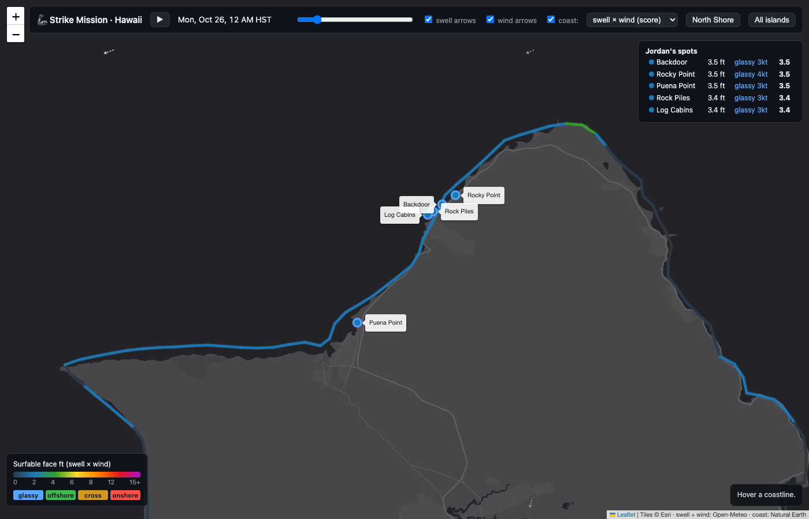
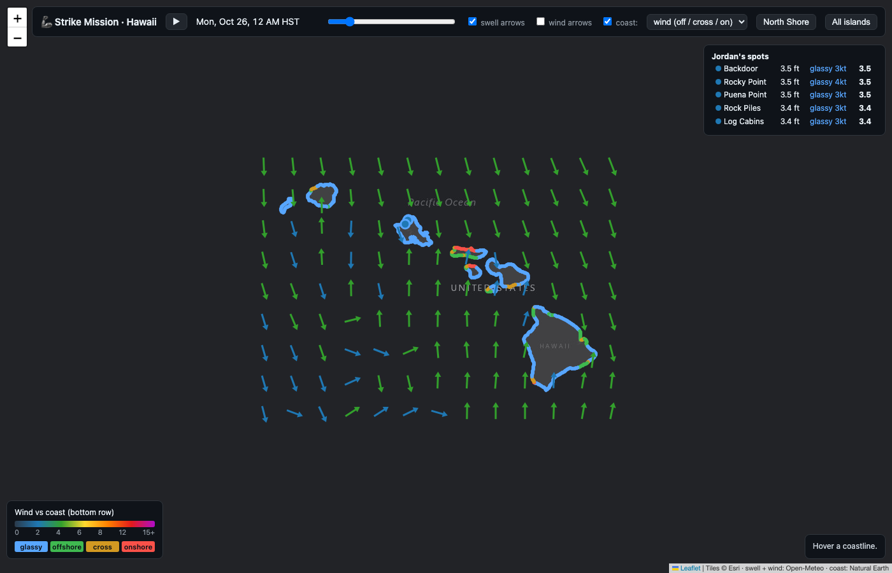
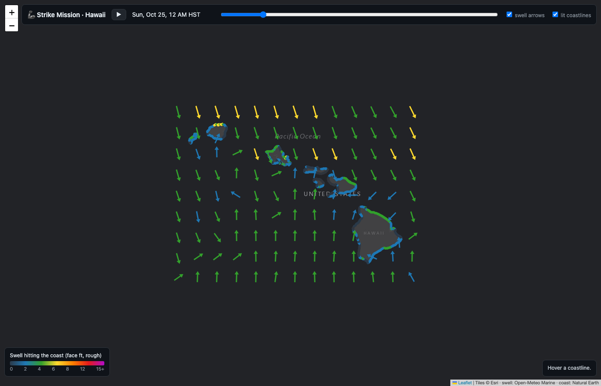

## Strike Mission Planner

A **strike mission** is a short-notice trip timed to a storm: you watch a system spin up
thousands of miles away, work out where its swell (or snow) will land, and go when the
window opens. I already spend a lot of time doing this by hand: flipping between forecast
sites, buoy readings, and wind models, then guessing which reef will actually be good.

This project automates that judgment. It's a passion project, built in public, with an AI
coding agent handling the plumbing while I own the physics and the scoring.



### The end goal

1. **Surf:** aggregate real-time weather and wave data, find where the world's storms will
   generate quality swell with favorable wind, and narrow it down to the specific reef.
   Eventually, "fact-check" the forecast against satellite observations of the ocean.
2. **Snow:** use the same storm tracking to forecast where storms will dump snow. The
   physics is different and it's new to me, so that half is a learning project too.

---

## Strategy

Before writing any code, I set a few ground rules. They've held up so far.

**Don't build a Surfline clone.** The wave physics is already solved. NOAA's
WAVEWATCH III, ECMWF, GFS, and the buoy network are public, and the big forecast apps are
built on top of them with decades of head start. A global swell chart isn't the product.
The product is a **decision layer**: given the storms and *my* constraints (home base,
travel windows, the spots I actually surf), where should I go, and is it worth it?

**Physics first, LLM second.** Wave heights come from wave models and buoys, never from a
language model. Code turns those numbers into scores. AI orchestrates the pipeline,
explains the call, and later helps read satellite products. It is never the source of a
number.

**Public data only.** Open-Meteo (wave + wind models), NOAA/NDBC buoys, PacIOOS (UH's
regional ocean models), Copernicus satellite data, and Natural Earth coastlines. No
scraping commercial forecast sites.

**I own the scoring.** The two functions that decide "is it good," `exposure()` for swell
and `windClass()` for wind, are mine to write and tune against what I see in the water.
The agent builds ingest, geometry, rendering, and git. Every design decision and known
gap gets written down in the repo the same day it's made.

**Start small and prove it.** One region, my spots, and an honest list of what's wrong
before expanding.

---

## How it works

Windy-style map with stacked layers and a 7-day time slider in 3-hour steps:

- **Layer 1, swell:** arrows on an ocean grid showing where swell is coming from, colored
  by size.
- **Layer 2, lit coastlines:** the coast is cut into ~1 km segments. Each one is colored by
  how much of the current swell actually reaches it.
- **Layer 3, wind:** wind arrows, plus every coast segment rated glassy / offshore /
  cross-shore / onshore relative to the direction that coast faces.
- **Spot pins + ranking:** my breaks are pinned and ranked for whatever time the slider is
  on, showing face height, wind rating, and a combined score.

```
scripts/build_coast.py   coastline polygons → ~1 km segments, each with the compass
                         bearing it faces + which bearings other islands block (run once)
scripts/fetch_swell.py   Open-Meteo Marine 0.5° grid, primary + secondary swell + wind sea
scripts/fetch_wind.py    Open-Meteo 10 m wind, 0.25° grid + one point per spot
web/index.html           Leaflet map; exposure() and windClass() are the scorers
```

The Python is standard-library only and the frontend has no build step, so it runs
anywhere with `python3` and a browser.

### The scoring model (v0, deliberately crude)

For each coast segment and each swell train:

1. The swell has to come from within ±90° of the direction the coast faces.
2. Height falls off with the angle between swell and coast. Long-period swell (12 s+)
   wraps more, so it gets a gentler falloff.
3. If another island sits on that bearing (rays cast out 250 km), the swell is blocked.
   That captures things like Molokai and Lanai shadowing Maui.
4. Swell trains combine like energy (square root of the sum of squares), then convert to
   approximate face height with a period-based shoaling factor.

Wind is scored by the angle between the wind and dead offshore for that coast. Glassy
(under 5 kt) or offshore keeps the full height; strong onshore cuts it to 20%. Very strong
offshore also gets penalized, because you can't paddle into it.
**Score = face height × wind factor.**



---

## How it's been refined: Hawaii → Oahu's North Shore

**v0.1, all of Hawaii.** The first spike lit up the coastline of every main island against
the live swell forecast. The geometry worked: north shores lit up on a north swell,
south shores stayed dark, and island shadowing showed up where it should.



It also showed the limits of doing everything at once. The global coastline dataset is
too coarse at surf-spot scale. The computed facing direction was 20–30° off at real
breaks (Pipeline read ~304° when it actually faces ~330°+), and that's the difference
between a swell hitting a reef and missing it.

**v0.2, focused on Oahu.** Instead of trying to be right about every mile of coast in the
state, I narrowed to the spots I actually surf on **Oahu's North Shore**: **Rocky Point,
Backdoor, Rock Piles, Log Cabins, and Puena Point**. Each spot now has a hand-set facing
direction, swell-direction window, and minimum period, which sidesteps the coarse-coastline
problem where it matters. This version also added the wind layer, because offshore vs.
onshore is half of whether a swell is actually surfable.

The other islands still render, but accuracy work goes into Oahu first.

### Known gaps (honest list)

- Spot facings and swell windows are starting guesses; they get corrected from real
  sessions.
- The wind forecast is ~10 km resolution, so the Pipeline-area spots share one wind
  reading. It's area wind, not per-reef wind.
- The swell grid is ~50 km. Nearshore detail needs a higher-resolution model.
- No tide yet, and no accounting for the daily trade-wind cycle.
- No evaluation loop yet. Until forecasts are checked against buoys and my own session
  reports, the scores are a hypothesis.

---

## What's next

**Finish Oahu properly**

- Swap in PacIOOS's SWAN nearshore wave model for Oahu (~500 m resolution) to get
  reef-scale detail.
- Build the evaluation loop: forecast vs. NDBC buoys (Waimea, NW Hawaii) vs. a log of
  what each session was actually like. That log becomes the ground truth for tuning
  `exposure()` and `windClass()`.
- Add tide, a sharper coastline, and correct every spot's facing from real sessions.

**Layer 1 goes Pacific-wide: the storm map**

Hawaii's swell is born 1,500–5,000 miles away, in Aleutian and Kuril lows in winter and the
Southern Ocean / New Zealand in summer. The next map zooms out to the North and South
Pacific to show where the storm is, how long its wind fetch is aimed at the islands, and
when its swell arrives. Zoom back in to see which coasts light up.

**Snowstorm forecasting**

Snow uses the same storm tracker but needs a separate scorer, because the physics is
different. Instead of swell direction and wind, the variables are:

- **Precipitation** (how much water the storm drops) and **humidity / moisture transport**
  (atmospheric rivers feed the big West Coast storms)
- **Snow level / freezing level**: whether it falls as snow at the resort's base and
  summit, or as rain
- **Temperature through the column → snow-to-liquid ratio**: cold storms make light
  powder, warm storms make heavy "Sierra cement"
- **Orographic lift**: mountains facing into the storm's flow wring out far more snow, the
  same "which way does it face" idea as a coastline facing a swell
- **Wind** on the ridges (loading, closures) and **avalanche danger** as a safety gate

The first snow region will likely be the Sierra Nevada, then expand from there. This is
where I'm learning the most: I know how to read a swell chart; reading a snow forecast is
new.

**Later**

- **Satellite fact-check:** use Copernicus Sentinel-1 SAR wave spectra to check whether
  the forecast swell actually exists in the open ocean.
- **Alerts:** a ping when a strike window opens for my spots.
- **A public app** extending from this portfolio.

---

### Build log

| Version | Date | What changed |
|---|---|---|
| Plan | Oct 20, 2026 | Strategy set: decision layer, physics-first, public data, surf first |
| v0.1 | Oct 24, 2026 | Hawaii map: coast facing + island shadow, live swell, time slider |
| v0.2 | Oct 25, 2026 | Wind layer (off/cross/onshore), Oahu North Shore spot pins + ranking |

The source repository will be published alongside this page as the project matures.
